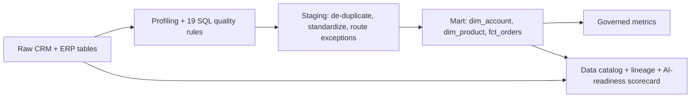

# Commercial Data Governance & AI-Readiness Catalog

**Turn raw CRM and ERP sales data into trusted, documented, AI-ready data: quality rules, a data catalog with owners and business definitions, lineage, governed metric definitions, and an AI-readiness scorecard.**

Runs on a **simulated** medical-device commercial dataset (accounts, sales reps, territories across the US, Canada and Latin America, products, 60,000 order lines) with data-quality problems planted on purpose, so every rule can be checked against known truth. Not real company data.

## Pipeline



| Component | What it does |
|---|---|
| **Data quality rules** (`govern/governance.py`) | 19 SQL rules across completeness, uniqueness, validity, integrity, timeliness, consistency and reconciliation, run on raw *and* mart tables |
| **Transform** (`sql/transform.sql`) | Merges duplicate accounts, takes country from the territory master, maps categories to a governed list, and sends every rejected record to an **exceptions queue** with a reason |
| **Data catalog** (`config/catalog.yaml` + profiling) | Business metadata (owner, steward, source, definition, sensitivity/PII) merged with technical metadata (type, null %, distinct, min/max) → `docs/data_catalog.md` |
| **Lineage** (`config/lineage.yaml`) | Source system → raw → staging → mart → metric; every metric is traced back to its raw source → `docs/lineage.md` |
| **Governed metrics** (`config/metrics.yaml`) | One definition, owner, grain and SQL per business metric (a small semantic layer) |
| **AI-readiness scorecard** | Per table: completeness, validity, uniqueness, documentation, classification, lineage. **Certified** only if every rule passes and every column is documented and classified |

## Results (`python run.py`)

| Metric | Value |
|---|---|
| Tables / columns cataloged | 8 / 50 |
| Catalog coverage (definition + owner): raw → mart | **70.4% → 100%** |
| PII columns tagged | 2 (rep name, rep email) |
| Quality rules failing: raw → mart | **9 of 10 (369 rows) → 0 of 9** |
| Duplicate accounts merged | 40 |
| Order lines: raw → certified | 60,000 → 58,989 |
| Records in the exceptions queue | 1,036, each with a reason |
| Reconciliation | raw orders = certified + exceptions (rule `mart-REC-1` passes) |
| Governed metrics traced to source | 5 of 5 |
| Tables certified AI-ready | **4 of 8** (all 3 mart tables + territory master); raw tables "Not ready" |

> 💡 **The pipeline caught its own gap.** A first version dropped 731 orders silently: orders from accounts with no territory fell out at a join and never reached the exceptions queue. A reconciliation rule (raw = certified + exceptions) now makes any silent drop fail.

**Exceptions queue:** account has no territory 731 · orphan account 120 · non-positive quantity 80 · unknown SKU 50 · future order date 30 · account missing territory 25.

## Outputs

- `governance_report.xlsx`: Summary, Data Catalog, Quality Rules, AI Readiness, Governed Metrics, Lineage, Exceptions
- `docs/data_catalog.md`: browsable catalog, with ⚠️ on every undocumented or unclassified column
- `docs/lineage.md`: Mermaid lineage diagram and metric-to-source trace

## Run

```bash
pip install -r requirements.txt
python run.py
pytest -q        # 6 tests
```

Tests check that the rules catch **exactly** the planted issues, every mart rule passes and reconciles, the mart is fully documented and PII-tagged, **Net Sales from the governed SQL matches an independent pandas calculation**, every metric traces to a raw source, and only clean tables are certified.

## Limitations

- SQLite stands in for a cloud warehouse; YAML stands in for a catalog tool such as Atlan. The concepts (owners, definitions, lineage, certification) carry over; the tooling does not.
- Lineage is table-level and declared in YAML, not parsed from SQL.
- Simulated data: the rules catch the problems I planted; real CRM data will surface new ones.
