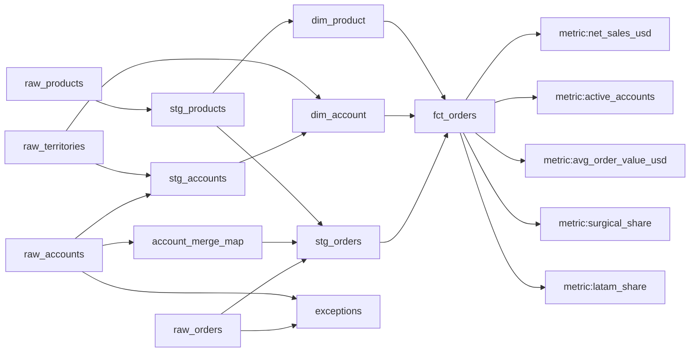

# Lineage

- **net_sales_usd** ← raw_accounts, raw_orders, raw_products, raw_territories
- **active_accounts** ← raw_accounts, raw_orders, raw_products, raw_territories
- **avg_order_value_usd** ← raw_accounts, raw_orders, raw_products, raw_territories
- **surgical_share** ← raw_accounts, raw_orders, raw_products, raw_territories
- **latam_share** ← raw_accounts, raw_orders, raw_products, raw_territories
